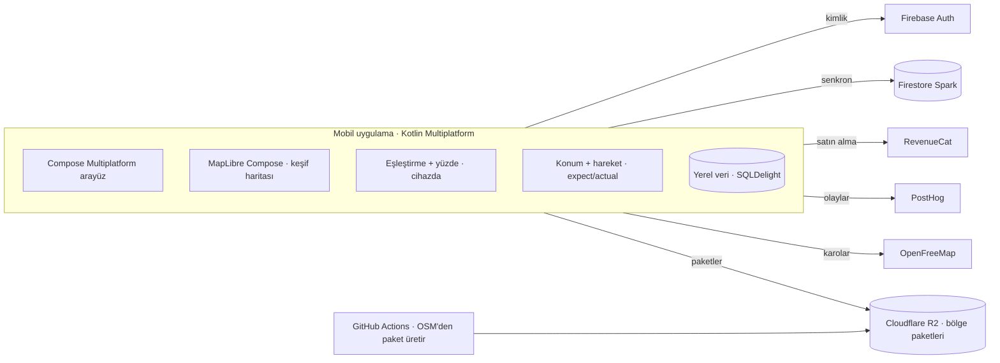

# Roadmaxxing — Teknik Mimari

Son güncelleme: 16 Kasım 2026

Uygulama, arayüz dahil tek bir Kotlin kod tabanıyla (Kotlin Multiplatform + Compose Multiplatform) iOS ve Android'e çıkar ve kendi sunucumuz olmadan, sıfır sabit maliyetle çalışır: yol eşleştirme ve yüzde hesabı telefonda yapılır, internette yalnızca statik dosyalar ve ücretsiz katmanlı servisler kalır.

## Kısıtlar

- Geliştiricinin Mac'i yok; tek bir iPhone'u var. iOS derlemesi ve TestFlight yüklemesi GitHub Actions'ın macOS runner'ında yapılır. Geliştirici daha önce KMP ile iOS uygulaması çıkardı ve bu akıştan memnun.
- Sunucu kurulumu ve sunucu maliyeti istenmiyor. Kendi backend'imiz, Cloud Functions (Blaze planı ve kredi kartı gerektirir) veya ücretli servis MVP'de yok.
- Kütüphaneler mümkün olduğunca resmî KMP SDK'ları olmalı. İstisna: Firebase (Google'ın resmî KMP SDK'sı yok, GitLive topluluk SDK'sı fiilî standart).

## Genel görünüm



## Teknoloji yığını

| Katman | Seçim | Ücretsiz sınır / not |
| --- | --- | --- |
| UI | Compose Multiplatform | Tek arayüz kodu; Android'de anında önizleme |
| Harita motoru | [MapLibre Compose](https://maplibre.org/maplibre-compose/) | MapLibre'nin resmî projesi; API henüz gelişiyor, minör sürümler kırıcı değişiklik içerebilir → sürüm sabitlenir |
| Harita karoları | [OpenFreeMap](https://openfreemap.org) | Ücretsiz, API anahtarı ve limit yok; hizmet "olduğu gibi" sunuluyor → B planı R2 üzerinden PMTiles |
| Yol verisi paketleri | OSM (Geofabrik) → GitHub Actions script'i → [Cloudflare R2](https://developers.cloudflare.com/r2/pricing/) | Ayda 10 GB depolama, 1 milyon yazma, 10 milyon okuma ücretsiz; internete çıkış ücretsiz |
| Yol eşleştirme ve yüzde | Ortak Kotlin kodu (`shared`), cihazda | Yön, hız ve süreklilik kontrolü yapan eşleştirici; sunucu yok |
| Kimlik | Firebase Auth, GitLive [firebase-kotlin-sdk](https://github.com/GitLiveApp/firebase-kotlin-sdk) | Apple, Google, e-posta ile giriş |
| Kullanıcı verisi | Firestore (Spark planı) | 1 GiB, günde 50 bin okuma, 20 bin yazma; ödeme yöntemi gerekmez |
| Abonelik | RevenueCat `purchases-kmp` | Resmî KMP SDK; aylık 2.500 $ gelire kadar ücretsiz, sonrası %1 |
| Analitik | PostHog [`posthog-kmp`](https://posthog.com/docs/libraries/kmp) | Resmî KMP SDK; pre-release → tam sürüme sabitlenir |
| Ağ | Ktor Client + kotlinx.serialization | |
| Yerel veri | SQLDelight | Ham iz, sürüşler, bölge paketleri, sürülen parçalar |
| DI ve mimari | Koin, MVI (ViewModel + StateFlow) | Navigasyon: Decompose veya Voyager (ilk kurulumda seçilecek) |
| Platform kodu | `expect/actual` | iOS: CoreLocation, CoreMotion (Kotlin/Native interop, Swift yok); Android: FusedLocationProvider, Activity Recognition, foreground service |
| CI/CD | GitHub Actions | Android: Play iç test; iOS: macOS runner + TestFlight |

## Önerilen modül yapısı

```
/composeApp      Ortak Compose UI, navigasyon, tema, string kaynakları (composeResources)
/shared          Domain + data: sürüş algılama mantığı, eşleştirme motoru, yüzde hesabı,
                 bölge paketi okuyucu, repository'ler, SQLDelight şeması
/androidApp      Android giriş noktası, foreground service, manifest izinleri
/iosApp          Xcode projesi (minimum; CI'da derlenir), Info.plist izin metinleri
/tools/regions   Bölge paketlerini OSM'den üreten script (GitHub Actions'ta çalışır)
```

İlk yapı kurulurken kullanıcıyla teyit edilir.

## Bölge paketleri

Amaç: Cihazın, internete gerek kalmadan, bir bölgedeki yolları ve toplam uzunlukları bilmesi.

- **Kaynak:** Geofabrik OSM çıkarımları (Türkiye ile başla).
- **Üretim:** `tools/regions` script'i GitHub Actions'ta (manuel tetikleme + ayda bir zamanlanmış) çalışır:
  1. Sürülebilir yolları `highway` etiketine göre süzer (bkz. PRD §7 tablosu).
  2. Yolları kavşaklardan parçalara böler; her parçaya kalıcı bir kimlik verir (OSM way id + sıra).
  3. İdari sınırları (`admin_level`, ülke bazlı eşleme tablosu) okur, her parçayı bölgelerine atar.
  4. Bölge başına toplam sürülebilir uzunluğu (ana yollar ve mahalle yolları ayrı) hesaplar.
  5. Çıktıyı karolara böler (ör. z12 veya z13 karo başına bir dosya: parça geometrisi + kimlik + yol tipi + bölge kimlikleri) ve bölge özet dosyası (bölge adı, `name:xx` çevirileri, toplam uzunluklar, sınır) üretir.
  6. Dosyaları sürüm etiketiyle R2'ye yükler (eski sürümler bir süre kalır).
- **Format:** Kompakt ikili veya sıkıştırılmış JSON; seçim Faz 0'da boyut ve okuma hızına göre yapılır.
- **Sürümleme:** Paket sürümü değişince parça kimlikleri mümkün olduğunca korunur; değişen parçalar için eşleme dosyası üretilir ki kullanıcının sürdüğü yollar kaybolmasın.

## Sürüş işleme akışı

1. Hareket sensörü (iOS CoreMotion `automotive`, Android Activity Recognition `IN_VEHICLE`) araç hareketini algılar; yüksek doğruluklu konum kaydı başlar (1 sn aralık).
2. 3 dakika duraklama + araç dışı hareket algılanınca sürüş biter. Hız ve yükseklik filtresi uçak ve tren izlerini eler. Trafikte duraklama sürüşü bölmez.
3. Gerekli bölge paketi cihazda yoksa R2'den indirilir ve önbelleğe alınır.
4. Cihazdaki eşleştirici izi yol parçalarına oturtur, yeni parçaları işaretler ve ilgili bölgelerin yüzdesini yerelde hesaplar.
5. Uygulama yolun yanma animasyonunu oynatır, özeti ve kartı hazırlar.
6. Hesap varsa sürüşün özeti, sadeleştirilmiş rotası ve ilk sürdüğü parça kimlikleri tek bir kayıt olarak Firestore'a senkronlanır (bağlantı yoksa kuyrukta bekler; ham iz yüklenmez). Tetikleyiciler: her işlenen sürüş, uygulamanın öne gelmesi, "Şimdi senkronize et"; periyodik arka plan işi yoktur. Bkz. karar 94–106.

## Eşleştirme motoru (cihazda)

- Saf Kotlin, platformdan bağımsız, birim testli; ürünün kalbi.
- Girdi: zaman damgalı GPS noktaları (koordinat, hız, yön, doğruluk). Çıktı: sürülen parça kimlikleri ve kaplama oranları.
- Yaklaşım (Faz 0'da doğrulanacak): aday parçaları uzaklığa göre seç → yön ve hız uyumuyla puanla → ardışık noktalar arasında yol ağı sürekliliğini kontrol et (gerekirse basit bir HMM / Viterbi) → parça kaplaması ≥ %70 ise "sürüldü".
- Paralel yollar, köprüler ve tüneller için test senaryoları yazılır.
- Pil için eşleştirme canlı değil, sürüş bittikten sonra toplu yapılır.

## Veri modeli

| Varlık | Alanlar | Nerede |
| --- | --- | --- |
| `User` | kimlik, plan, tercihler (birim, sessiz saatler, harita katmanı seçimleri), ulaşılan kilometre taşları | Firestore (`users/{uid}`) + yerel |
| `Drive` | başlangıç/bitiş, karar, mesafe, süre, ortalama/maks hız, yeni km, sadeleştirilmiş rota (≤ ~300 nokta); yerelde ayrıca `sync_id`, `synced_at_ms`, `remote_route` | Yerel + Firestore (`users/{uid}/drives/{syncId}`) |
| `TracePoint` | zaman, koordinat, hız, yön, doğruluk | Sadece yerel |
| `Segment` | OSM parça kimliği, uzunluk, yol tipi, bölge kimlikleri | Bölge paketi |
| `DrivenSegment` | kullanıcı, parça kimliği, ilk sürülüş tarihi | Yerel; Firestore'da ayrı doküman değil, o parçayı ilk süren sürüş dokümanında kimlik listesi (delta-varint dizgesi) |
| `Region` | seviye, ad (çevirileriyle), toplam yol uzunluğu (tip bazlı) | Bölge paketi |
| `RegionProgress` | kullanıcı, bölge, sürülen uzunluk, yüzde | Yerel (türetilir); Firestore'a yüklenmez, geri yüklemede parça kimliklerinden yeniden hesaplanır |
| `PrivacyZone` | merkez, yarıçap | Yerel + Firestore (profil dokümanında) |

Firestore'da sürüş başına tek doküman yazılır (nokta nokta değil) ki ücretsiz kota uzun süre yetsin; 1 saatlik sürüş yaklaşık 8 KB, doküman üst sınırı 900 KB (aşılırsa önce rota ayrıntısı atılır). Birleştirme: segmenti ilk süren en eski sürüştür; profil son yazan kazanır, kilometre taşları birleşimdir.

## Firestore güvenlik

Her kullanıcı yalnızca kendi `users/{uid}/...` yolunu okuyup yazabilir; kurallar ayrıca doküman şemasını doğrular (alan beyaz listesi, tip ve boyut sınırları). Kurallar dosyası depoda tutulur ve CI'da doğrulanır.

## CI/CD

- **Android:** Her PR'da derleme + birim testleri; `main`'de Play iç test kanalına yükleme.
- **iOS:** macOS runner'da Kotlin framework + Xcode derlemesi; etiketle tetiklenen iş TestFlight'a yükler. İmzalama ve App Store Connect anahtarı GitHub secrets'tan.
- **Bölge paketleri:** `tools/regions` işi manuel tetikleme ve aylık zamanlama.

## Gizli değerler

`google-services.json`, `GoogleService-Info.plist`, RevenueCat ve PostHog anahtarları, imzalama dosyaları depoya girmez. Yerelde `local.properties` / `.xcconfig` (gitignore'da), CI'da GitHub Actions secrets kullanılır.

## Sonraki sürümlerde değişecekler

- Liderlik tabloları ve arkadaşlar sunucu tarafı hesap ister → Cloud Functions (Blaze planı) veya başka bir çözüm.
- CarPlay ve Android Auto şablon tabanlıdır; özel harita çizimi büyük ihtimalle yalnızca navigasyon kategorisine izinli. Basit bir "driving task" deneyimi (canlı yeni km, bildirim) daha gerçekçi. Kesinleştirmeden önce güncel Apple ve Google dokümanları kontrol edilmeli.
