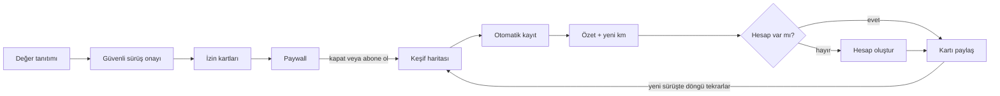

# Roadmaxxing — MVP Ürün Gereksinimleri Dokümanı (PRD)

Son güncelleme: 16 Kasım 2026 · Sahibi: Mehmetcan

Teknik ayrıntılar `ARCHITECTURE.md`, görsel dil `DESIGN.md`, marka `BRAND.md`, pazar araştırması `RESEARCH.md` dosyalarındadır.

## 1. Ne inşa ediyoruz

Ürünün kalbi tek bir fikir: sürdüğün her yol haritanda yeşile döner ve uygulama sana şehrinin yüzde kaçını keşfettiğini söyler. Roadmaxxing, arabayla gezdikçe şehrini, ülkeni ve dünyayı bir oyundaki gibi tamamladığın, iOS ve Android'de çalışan bir sürüş takip uygulamasıdır.

- **Tek cümlelik vaat:** "Sürdüğün her yol senin olsun. Adana'nın %12,4'ünü keşfettin."
- **Konumlandırma:** Sürüş için Wandrer. Hız istatistikleri ikinci planda, keşif ve tamamlama ana mesajdır. Rakipler (Wheelz, TripRank) "ne kadar hızlı sürdün" sorusunu, biz "nereleri sürdün, nereleri henüz sürmedin" sorusunu yanıtlarız.
- **İlham:** Euro Truck Simulator 2'de harita tamamlama. Keşfedilen yollar renkli, keşfedilmeyenler gri.
- **Büyüme motoru:** Her sürüşten ve her yeni yüzdeden sonra oluşan, Instagram Story oranında paylaşılabilir kart.
- **MVP hedefi:** Ana döngüyü (otomatik kayıt → yolların boyanması → yüzde → kart → paylaşım) iki platformda, birden fazla dilde, abonelik altyapısıyla yayınlamak. Geri kalan her şey sonraki sürümlere.

## 2. Kimin için

Ana hedef kitle, arabayı sadece ulaşım aracı olarak değil, kendini ifade etme aracı olarak gören 18-35 yaş arası sürücüler. Lansman pazarı Türkiye; ilk günden İngilizce ve birkaç büyük dilde global.

| Persona | Kim | Ne ister | Bizde ne bulur |
| --- | --- | --- | --- |
| Araba tutkunu | 20'li yaşlarda, araba kültürünü takip ediyor, Wheelz veya TripRank kullanmış | Sürüşlerini göstermek, arkadaşlarıyla kıyaslamak | Paylaşım kartı, yüzde rekabeti |
| Kaşif / tamamlamacı | Oyun oynayan, Fog of World veya Wandrer tarzı uygulamaları seven | Haritayı doldurmak, %100'e ulaşmak | İlçe ve yol tipi hedefleri, keşfedilmemiş yollar katmanı |
| Yolculuk sever | Hafta sonu uzun yola çıkan, yeni şehirler gezen | Gittiği yerlerin kalıcı bir günlüğü | Şehir pasaportu, rota geçmişi, yeni şehir kartı |
| Günlük sürücü | İşe arabayla giden, her gün aynı yolu kullanan | Rutini kırmak için küçük bir sebep | "Bugün 3 km yeni yol" gibi mikro hedefler |

Kapsam dışı: filo yönetimi, kilometre ve vergi takibi yapan profesyoneller, motosiklet ve bisiklet (sonraki sürümlerde değerlendirilebilir).

## 3. Neden şimdi: doğrulama

Harita tamamlama mekaniği yürüyüş, koşu ve bisiklette para kazandırıyor; sürüşte ise bu niş henüz neredeyse boş. Rakiplerin en büyük zayıflığı (sıkıcılaşma) bizim ana mekaniğimizin doğrudan çözdüğü sorun. Ayrıntılar ve kaynaklar: `RESEARCH.md`.

## 4. Değer önerisi

Kullanıcıya her sürüşün bir anlamı olduğunu hissettiriyoruz: sıradan bir iş yolu bile haritaya bir çizgi, yüzdeye bir artış ekler.

1. **İlerleme hissi:** Şehrin, ilçen ve ülken için somut bir yüzde. Her yeni yol anında yeşil yanar.
2. **Küçük, ulaşılabilir hedefler:** "Seyhan %41", "Ana yollar %64", "Bu hafta 12 km yeni yol". Son %10 problemine karşı katmanlı hedefler.
3. **Kendini ifade etme:** Hikâye anlatan, tek bakışta okunan, her şehirde farklı görünen paylaşım kartı.
4. **Zahmetsizlik:** Buton yok. Uygulama sürüşü kendi algılar, kaydeder, haritayı kendi boyar.
5. **Güven:** Gizlilik bölgeleri, isteğe bağlı bildirimler, şeffaf izin ekranları, Apple, Google ve e-posta ile giriş.
6. **Klasik sürüş istatistikleri:** Ortalama ve maksimum hız, mesafe, süre, rota geçmişi. Rakiplerde olan her temel bilgi bizde de var, ama ana sahnede değil.

## 5. MVP kapsamı

MVP 10 temel özellikten oluşuyor; P0'lar olmadan yayına çıkmayız, P1'ler zaman kalırsa girer.

| # | Özellik | Kapsam | Öncelik |
| --- | --- | --- | --- |
| 1 | Otomatik sürüş algılama ve kayıt | Arka planda konum + hareket algılama; manuel başlat/durdur; uçak ve toplu taşıma filtresi; trafikte kesilmeme | P0 |
| 2 | Yol eşleştirme (map matching) | GPS izini OSM yol parçalarına cihazda oturtma, sürülen parçaları işaretleme | P0 |
| 3 | Keşif haritası | Koyu harita; sürülen yollar Volt yeşili, sürülmeyenler gri; yeni açılan yolun animasyonu | P0 |
| 4 | Tamamlama yüzdeleri | Ülke, şehir, ilçe yüzdesi; yol tipi kırılımı (ana yollar / mahalle yolları) | P0 |
| 5 | Sürüş özeti | Mesafe, süre, ortalama ve maksimum hız, yeni açılan km, rota | P0 |
| 6 | Paylaşım kartı | Sürüş kartı ve şehir kartı; 9:16 Story ve 4:5 gönderi; logo; gizlilik bölgesi bulanıklaştırması | P0 |
| 7 | Onboarding ve izinler | Değer anlatımı, güvenli sürüş onayı, kart kart izin ekranı | P0 |
| 8 | Hesap ve senkronizasyon | Firebase Auth (Apple, Google, e-posta); hesap ilk paylaşımda veya 3. sürüşten sonra istenir; misafir verisi hesaba taşınır | P0 |
| 9 | Abonelik ve paywall | RevenueCat; haftalık, aylık, yıllık plan; cömert bir ücretsiz katman; davetle Pro haftası | P0 |
| 10 | Ayarlar | Gizlilik bölgeleri, sessiz saatler, birim (km/mil), dil, veri dışa aktarma ve hesap silme | P1 |

**MVP'de yok, sonraki sürümlerde:** liderlik tabloları ve arkadaşlar, ana ekran widget'ları, CarPlay ve Android Auto, yapay zekâ özellikleri (rota önerisi, sürüş özeti), premium harita temaları, keşfedilmemiş yollara rota oluşturma, araç garajı ve çoklu araç, rozetler ve görevler, konvoy ve canlı konum, Apple Watch.

## 6. Uygulama akışı

Kullanıcı 4 ekranlık onboarding'den sonra doğrudan haritaya düşer; hesap yalnızca ilk paylaşımda veya 3. sürüşten sonra istenir.



Hesap oluşturan kullanıcının misafir verisi (sürüşler, açılan yollar) kayıpsız hesaba taşınır.

**Ekranlar:**

1. **Değer tanıtımı (1-2 ekran):** "Sürdüğün her yol senin olsun" mesajı, gri bir şehir haritasının yeşile dönmesini gösteren kısa animasyon.
2. **Güvenli sürüş onayı:** "Telefona dokunma" ve "Kurallara uy" maddeleri; güvenli sürüş ile şartlar ve gizlilik politikası için iki onay kutusu.
3. **İzin kartları:** Konum ("Her zaman izin ver" + kesin konum), hareket ve fiziksel aktivite, bildirimler (isteğe bağlı). Her kartın kendi butonu ve neden istendiği açıklaması var; reddedilen izin için Ayarlar'a yönlendirme.
4. **Paywall:** Kapatılabilir; yıllık plan varsayılan seçili.
5. **Keşif haritası (ana ekran):** Tam ekran koyu harita, üstte şehir yüzdesi kartı, altta yüzen sekme çubuğu. Boş durumda "İlk yolunu aç" daveti.
6. **Sürüşler:** Tarih sıralı liste; her sürüşün mini rota çizimi ve yeni km rozeti.
7. **İstatistikler:** Ülke, şehir, ilçe yüzdeleri; yol tipi kırılımı; toplam km ve süre; hız istatistikleri.
8. **Profil ve ayarlar:** Hesap, abonelik, gizlilik bölgeleri, sessiz saatler, birim, dil, davet.

## 7. Harita tamamlama mantığı

Yüzde, bir bölgede sürülen sürülebilir yol uzunluğunun o bölgedeki toplam sürülebilir yol uzunluğuna oranıdır; her yol parçası kullanıcı başına yalnızca bir kez sayılır.

```
Tamamlama (%) = Σ sürülen eşsiz parça uzunluğu / Σ bölgedeki sürülebilir yol uzunluğu × 100
```

**Veri kaynağı:** OpenStreetMap. Yol ağı ve idari sınırlar GitHub Actions'taki bir script ile bölge paketlerine önceden işlenir; ayda bir güncellenir.

**Hangi yollar sayılır** (OSM `highway` etiketi):

| Katman | OSM etiketleri | Notu |
| --- | --- | --- |
| Ana yollar | motorway, trunk, primary, secondary, tertiary (+ _link) | Şehir yüzdesinde ayrı gösterilir |
| Mahalle yolları | residential, unclassified, living_street | Yüzdenin en zor kısmı |
| Sayılmaz | service, track, path, footway, cycleway, private ve `access=no` olanlar | Otopark, site içi ve araca kapalı yollar paydaya girmez |

**Bölge hiyerarşisi:** Dünya → ülke → 1. seviye (Türkiye'de il, ABD'de eyalet) → 2. seviye (ilçe, county). OSM `admin_level` değerleri ülke bazlı bir eşleme tablosuyla normalize edilir.

**Kurallar:**

- Bir parça, en az %70'i eşleşen GPS noktalarıyla kaplanınca "sürüldü" sayılır; tek yönlü veya çift yönlü fark etmez.
- Paralel yollarda yanlış eşleşmeyi önlemek için hız, yön ve yol tipi birlikte değerlendirilir.
- Ana döngü çevrimdışı da çalışır: bölge paketi bir kez indirildikten sonra eşleştirme ve yüzde hesabı tamamen cihazda yapılır.
- Hedef: sürüş bittikten sonra en geç 60 saniyede harita ve yüzde güncellenmiş olur.
- Kilometre taşları: %1, %5, %10, %25, %50, %75, %90, %100 ve bir ilçenin tamamlanması kutlama ekranı ve kart üretir.

## 8. Paylaşım kartı

Kart ürünün reklamıdır: tek bakışta okunmalı, her şehirde farklı görünmeli ve her zaman logomuzu taşımalı.

| Kart | Ne zaman oluşur | Ana içerik |
| --- | --- | --- |
| Sürüş kartı | Her sürüşün sonunda | Rota çizimi (yeni açılan kısımlar Volt yeşili), yeni km, mesafe, süre, ortalama/maks hız |
| Şehir kartı | İstendiğinde ve kilometre taşlarında | Şehir silueti içinde sürülen yollar, büyük punto yüzde, tamamlanan ilçe sayısı |
| Yeni şehir kartı | Bir şehre ilk girişte | Pasaport damgası estetiği, şehir adı, tarih, ilk sürülen km |

**Format:** 9:16 Story (1080×1920) varsayılan; 4:5 gönderi (1080×1350) alternatif. Instagram Story'ye doğrudan paylaşım, sistem paylaşım menüsü ve galeriye kaydetme.

**Kurallar:**

- Logo ve uygulama adı her kartta görünür; Pro kullanıcılarında daha küçük ama kaldırılamaz.
- Tek bir dev sayı (yüzde veya yeni km), en fazla 3 destek istatistiği.
- Gizlilik bölgeleri (ev, iş) haritadan otomatik kesilir; kullanıcı hız bilgisini kart üzerinde gizleyebilir.
- Kart cihazda üretilir (Compose ile çizilip görüntüye dönüştürülür); internet gerektirmez.
- MVP'de 1 ücretsiz kart stili + 2 Pro stil; sonraki sürümlerde premium harita temalarıyla genişler.

**Kimsede olmayan istatistikler (MVP'de en az ikisi):** bu haftaki yeni yol km'si, tamamlanan ilçe sayısı (3/15), "ilk kez sürdüğün sokak" sayısı, şehrin ana yollarının yüzdesi.

## 9. Monetizasyon

Ana döngü ücretsiz kalır; Pro derinlik, geçmiş ve kişiselleştirme satar. Paywall lansmanda açıktır ama cömerttir; kullanıcı değeri görmeden duvara çarpmaz.

| Özellik | Ücretsiz | Pro |
| --- | --- | --- |
| Otomatik kayıt ve keşif haritası | Sınırsız | Sınırsız |
| Ülke ve şehir yüzdesi | Var | Var |
| İlçe ve yol tipi kırılımı | Sadece kendi şehrin | Tüm bölgeler |
| Sürüş geçmişi (detaylı) | Son 30 gün (harita kalıcı) | Sınırsız |
| Paylaşım kartı | 1 stil | Tüm stiller, küçük logo |
| Keşfedilmemiş yollar katmanı | Yok | Var |
| Veri dışa aktarma (GPX) | Yok | Var |

Önemli kural: Sürülen yollar haritadan hiçbir zaman silinmez. 30 gün sınırı sadece sürüş detaylarını (hız grafiği, rota tekrarı) kapsar; TripRank'teki "kendi verini göremiyorsun" hatasını tekrarlamayız.

**Fiyatlandırma (başlangıç, A/B testine açık):**

| Plan | ABD | Türkiye | Not |
| --- | --- | --- | --- |
| Yıllık | 39,99 $ | ₺699,99 | Varsayılan seçili, 7 gün ücretsiz deneme |
| Aylık | 7,99 $ | ₺119,99 | |
| Haftalık | 3,99 $ | ₺59,99 | |

Referans: Wheelz şu an yıllık ₺2.259,99, aylık ₺279,99, haftalık ₺169,99 (uygulama içi ekran görüntüsü, 16 Kasım 2026); ABD'de 49,99 / 9,99 / 4,99 $. Türkiye'de Wheelz'in yaklaşık yarısı fiyatındayız; yıllık plan aylığın 6 katından ucuz, paywall'da "%50 tasarruf" olarak gösterilir.

**Davet modeli:** Uygulamaya katılıp ilk sürüşünü tamamlayan her arkadaş için 1 hafta Pro, en fazla 8 hafta. Sahte hesapları engellemek için "ilk sürüşü tamamlama" şartı var.

**Paywall ne zaman görünür:** Onboarding sonunda bir kez (kapatılabilir), kilitli bir özelliğe dokunulduğunda ve kilometre taşı kutlamalarından sonra. Gece indirim bildirimi, sahte çark, kapatılamayan ekran yok.

## 10. Tasarım dili (özet)

Ana renk keşfedilen yolun rengidir: Volt yeşili `#C8FF3D`. Uygulama yalnızca koyu temada çalışır; kategorinin alışılmış iskeletini (Wheelz referansı) korur, farklılığı harita stili ve paylaşım kartıyla yaratır. Token'lar, tipografi, bileşenler ve referans analizi: `DESIGN.md`.

## 11. Teknik mimari (özet)

Tek Kotlin kod tabanı (KMP + Compose Multiplatform), kendi sunucumuz yok, sıfır sabit maliyet: yol eşleştirme ve yüzde hesabı telefonda yapılır; harita karoları OpenFreeMap, bölge paketleri Cloudflare R2, kullanıcı verisi Firestore Spark. Ayrıntılar: `ARCHITECTURE.md`.

## 12. Gizlilik, yerelleştirme ve analitik

Gizlilik bir özellik olarak pazarlanır; yerelleştirme ilk günden tamdır; analitik yalnızca ürün kararları için toplanır.

**Gizlilik:**

- Konum verisi üçüncü taraflara satılmaz ve PostHog'a gönderilmez (olaylarda koordinat yok, sadece bölge kimliği).
- Gizlilik bölgeleri: kullanıcı ev ve iş gibi noktaları 200-1000 m yarıçapla işaretler; bu bölgeler kartlarda ve paylaşılan haritalarda kesilir. İlk 5 sürüşten sonra en sık başlanılan nokta için öneri gösterilir.
- Hesap silme ve tüm veriyi dışa aktarma (GDPR, KVKK) uygulama içinden yapılır.
- İzin metinleri her platformda neden istendiğini açıkça söyler; App Store incelemesi için arka plan konum kullanımını gösteren bir demo videosu hazırlanır.
- OSM verisi kullanıldığı için uygulamada "© OpenStreetMap katkıcıları" atfı gösterilir.

**Yerelleştirme:** Lansman dilleri Türkçe ve İngilizce; ilk güncellemede Almanca, İspanyolca, Fransızca, Portekizce, Arapça (sağdan sola düzen). Compose Multiplatform kaynak dosyaları (`composeResources/values-xx/strings.xml`) kullanılır; kodda sabit metin yok. Sayı, tarih ve birim (km/mil) biçimleri cihaz yerel ayarından gelir. Yer adları OSM `name:xx` etiketlerinden kullanıcının dilinde gösterilir. Mağaza metinleri ve ekran görüntüleri her dil için ayrı hazırlanır.

**Analitik olayları (PostHog):**

| Olay | Ne zaman | Özellikler |
| --- | --- | --- |
| `onboarding_completed` | Onboarding bittiğinde | izin durumu (konum, hareket, bildirim) |
| `drive_completed` | Sürüş kaydedildiğinde | mesafe_km, yeni_km, süre_dk, otomatik_mi |
| `milestone_reached` | Bir yüzde eşiği aşıldığında | bölge_tipi, eşik |
| `card_shared` | Kart paylaşıldığında | kart_tipi, hedef (instagram, sistem, galeri), stil |
| `account_created` | Hesap oluşturulduğunda | yöntem, tetikleyici (paylaşım, 3. sürüş) |
| `paywall_viewed` | Paywall açıldığında | kaynak |
| `subscription_started` | Satın alma | plan, deneme_mi |
| `invite_sent` / `invite_converted` | Davet gönderildiğinde / tamamlandığında | kanal |

## 13. Başarı metrikleri, riskler ve açık sorular

MVP'nin başarısı tek soruyla ölçülür: insanlar kartı paylaşıyor ve geri geliyor mu?

**Hedef metrikler (lansmandan sonraki ilk 90 gün):**

| Metrik | Hedef |
| --- | --- |
| Onboarding'de "Her zaman" konum izni verme oranı | %60+ |
| 7. gün tutundurma (D7) | %35+ |
| 30. gün tutundurma (D30) | %20+ |
| Aktif kullanıcı başına haftalık paylaşılan kart | 0,5+ |
| Ücretsiz → Pro dönüşüm | %3+ |
| Çökmesiz oturum | %99,5+ |

**Riskler ve önlemler:**

| Risk | Etki | Önlem |
| --- | --- | --- |
| Pil tüketimi | Silinme, kötü yorum | Sürüş yokken düşük doğruluklu konum; hareket sensörüyle tetikleme |
| App Store arka plan konum reddi | Lansman gecikmesi | Açık kullanım metni, demo videosu, özelliğin konuma gerçekten bağlı olduğunu göstermek |
| OSM verisinin eksik olduğu bölgeler | Yanlış yüzde | Pilot şehirlerde (Adana, İstanbul, Ankara) test; eksik yolları paydadan düşme |
| Son %10 problemi | Motivasyon kaybı | İlçe ve yol tipi hedefleri, haftalık yeni km hedefi |
| Cihazdaki eşleştirmenin yanlış yol seçmesi | Güven kaybı | Yön, hız ve süreklilik kontrolü; Faz 0'da pilot şehirde doğruluk testi |
| OpenFreeMap'in kapanması veya yavaşlaması | Harita görünmez | B planı: aynı karoları PMTiles olarak Cloudflare R2'den sunmak |
| Firestore ücretsiz kotasının dolması | Senkron durur | Sürüş başına tek kayıt; kota %70'e gelince Blaze planına geçiş |
| Rakip hızı (OVERDRIVE, Wheelz) | Pencere kapanır | MVP'yi dar tut, iki platformda aynı anda çık |
| MapLibre Compose ve PostHog KMP API'lerinin henüz stabil olmaması | Güncellemede kırılma | Tam sürüme sabitle, ince bir sarmalayıcı katman yaz |

**Açık sorular:**

- [ ] Alan adları (roadmaxxing.app, roadmaxxin.com, roadmaxing.com) ve sosyal medya kullanıcı adları alınacak mı? Marka tescili (TÜRKPATENT, EUIPO, USPTO) kontrolü. Durum: `BRAND.md`.
- [ ] Cihazdaki eşleştirme doğruluğu yeterli mi? Yetmezse hangi ücretsiz veya ucuz seçeneklere geçilir?
- [ ] Pilot şehirler hangileri olacak? (Öneri: Adana, İstanbul, Ankara)
- [ ] Lansman öncesi kapalı beta (TestFlight + Play kapalı test) kaç kişiyle ve ne kadar süre?
- [ ] Paket adı / bundle id (`app.roadmaxxing` önerisi) kesinleşecek mi?

**Yol haritası:**

1. **Faz 0, teknik doğrulama:** arka plan konum + cihazda map matching + yüzde hesabını tek şehirde (Adana) kanıtla.
2. **Faz 1, MVP:** bu dokümandaki P0 özellikler; kapalı beta.
3. **Faz 2, lansman:** Türkçe + İngilizce, App Store ve Google Play.
4. **Faz 3, büyüme:** liderlik tablosu ve arkadaşlar, widget, premium harita temaları, yeni diller.
5. **Faz 4, platform:** CarPlay, Android Auto, yapay zekâ rota önerileri.

**Faz 0 kabul ölçütü (öneri):** Gerçek bir iOS ve bir Android cihazda, uygulama kapalıyken başlayan 3 sürüş otomatik kaydedilir; sürülen yolların en az %90'ı doğru OSM parçasıyla eşleşir (elle kontrol); Adana ve Seyhan yüzdeleri sürüş bitiminden sonra 60 saniye içinde güncellenir; kayıt yokken pil tüketimi gözle görülür biçimde artmaz.
